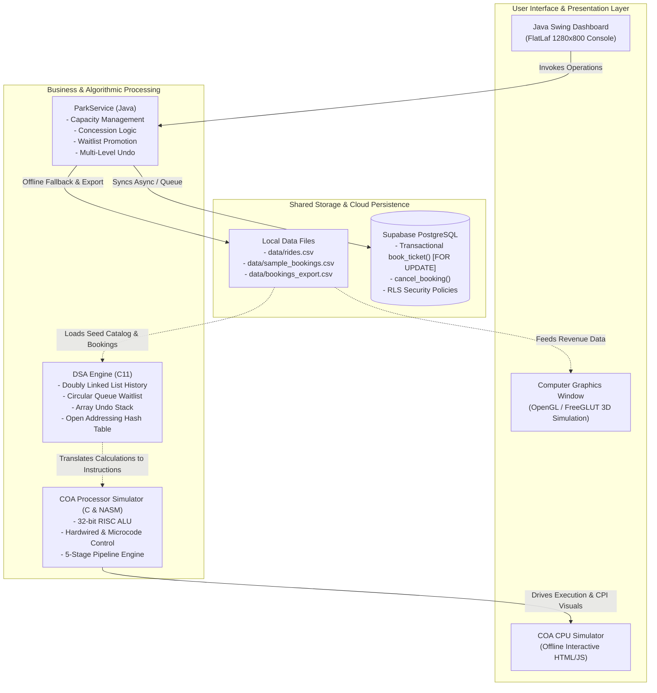

# System Architecture & Cross-Subject Integration

This document outlines the multi-tiered architecture of the Smart Amusement Park Management System (v2) and visualizes the cross-course data flow unifying Java, C (DSA), COA, and Computer Graphics.

---

## 1. High-Level Architectural Flow

---

## 2. Cross-Module Data Sharing Workflow

1. **Catalogue Definition:** `data/rides.csv` defines the canonical 4 rides (ID, Name, Capacity, Unit Price, Min Age). Both the Java Swing Dashboard and the C DSA Engine load this identical CSV at boot.
2. **Transaction Export:** The Java Dashboard features an "Export CSV" facility that writes `data/bookings_export.csv`.
3. **Graphics Visualization:** The Computer Graphics module reads the ride status and revenue totals to dynamically size the Cohen-Sutherland clipped bar chart in its secondary viewport.
4. **Processor-Level Simulation:** The COA simulator extracts critical operations (Fare Multiplication, Seat Verification, and Batch Revenue Accumulation) and demonstrates their cycle-accurate execution at the ALU and pipeline level.
